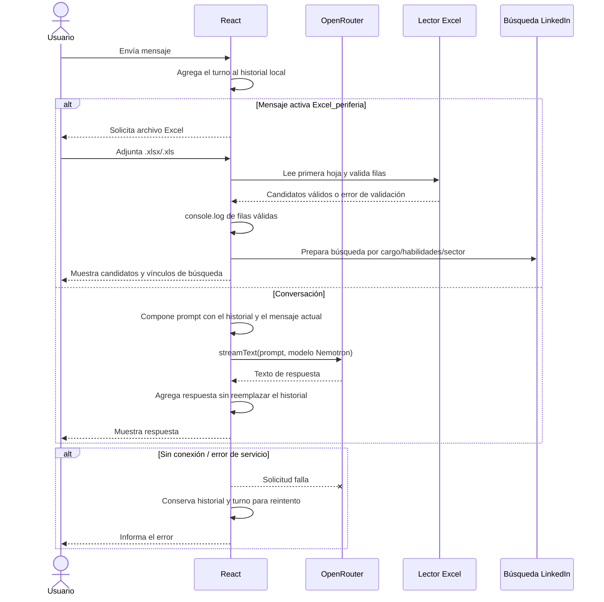

# Definición del agente: Excel_periferia

## Qué

Agente de conversación en React que conserva los mensajes entre turnos y recargas. La respuesta se genera directamente desde el frontend con el servicio OpenRouter definido. Cuando el usuario escribe `Excel_periferia`, solicita un Excel, valida candidatos, imprime las filas aceptadas en la consola y presenta búsquedas de LinkedIn para revisión manual.

## Para qué

1. Mantener la interfaz React existente. En el modo actual, el frontend presenta el chat, conserva el historial local y llama a OpenRouter con `streamText`.
2. Manejar falta de conexión, respuesta del proveedor, entradas inválidas y archivos dañados con mensajes visibles, preservando los turnos ya ingresados.
3. Procesar una tarea especializada activada por la frase `Excel_periferia`, sin impedir la conversación normal.

## Reglas del agente

- Cada mensaje y respuesta se agrega al historial. El historial visible se persiste en `localStorage`; el contexto anterior se incluye al solicitar una respuesta a OpenRouter.
- La clave se lee desde `VITE_OPENROUTER_KEY` en `.env` para la llamada desde navegador; Vite la incluye en el bundle.
- La activación `Excel_periferia` solicita `.xlsx` o `.xls`; solo procesa filas con nombre (`nombre` o `name`) y al menos un criterio (`cargo`, `perfil`, `titulo`, `habilidades`, `skills`, `sector` o `industria`). Las filas incompletas se omiten con aviso.
- Las filas aceptadas se muestran en la consola del navegador con el prefijo `[Excel_periferia]` y se presenta un vínculo de búsqueda para revisión manual.
- Las búsquedas en LinkedIn usan criterios orientativos de cargo, habilidades y sector. No se automatiza scraping, acceso a perfiles privados ni asignación de clientes: una persona revisa y decide.
- En error de conexión se conserva el turno y se habilita reintento. La clave y detalles internos del proveedor no se muestran al usuario.

## Secuencia

## Configuración local

1. Configura `VITE_OPENROUTER_KEY` en `.env` a partir de `.env.example`.
2. Ejecuta `npm run dev`.
3. Escribe `Excel_periferia` en el chat y selecciona un Excel.

Las pruebas automatizadas y manuales se describen en [PRUEBAS_AGENTE_EXCEL_PERIFERIA.md](./PRUEBAS_AGENTE_EXCEL_PERIFERIA.md). La integración OpenRouter y sus límites actuales se documentan en [FICHA_INTEGRACION_AGENTE_OPENROUTER.md](./FICHA_INTEGRACION_AGENTE_OPENROUTER.md).
