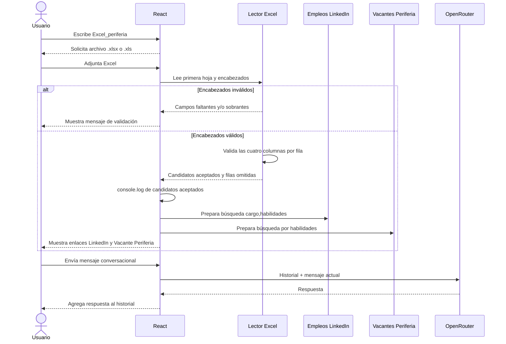

# Definición del agente: Excel_periferia

## Qué

Agente conversacional en React que conserva el historial visible en `localStorage`. Cuando el usuario escribe `Excel_periferia`, solicita un archivo Excel, valida su estructura, muestra las filas aceptadas en la consola del navegador y ofrece dos búsquedas de vacantes por candidato: LinkedIn y el portal de empleo de Periferia IT.

## Para qué

1. Mantener la interfaz React actual y separar la conversación normal de la tarea especializada de Excel.
2. Conservar el historial y el mensaje fallido cuando haya un problema de conectividad, con opción de reintento.
3. Validar candidatos y facilitar la consulta manual de vacantes que coincidan con su cargo y habilidades.

## Reglas del agente

- Cada turno se agrega al historial; este se persiste en `localStorage` con la clave `agente-periferia-history-v1`.
- La conversación normal envía el historial más el turno actual a OpenRouter mediante `src/services/prom.service.ts`.
- El comando `Excel_periferia` abre el selector de archivos y solo admite `.xlsx` o `.xls`.
- La primera hoja debe contener únicamente estas columnas, sin importar mayúsculas o espacios alrededor del encabezado: `nombre`, `cargo`, `habilidades`, `industria`.
- Si la estructura no coincide, el agente informa los campos faltantes y los campos sobrantes. No procesa candidatos en ese caso.
- Una fila se acepta solo si los cuatro campos requeridos contienen datos. Las filas incompletas se omiten y se informa su cantidad.
- Los candidatos aceptados se registran en la consola del navegador con el prefijo `[Excel_periferia] Candidatos validados:`.
- Cada candidato conserva dos enlaces:
  - **Buscar empleos en LinkedIn:** consulta el portal de empleos con `cargo,habilidades` como palabras clave.
  - **Vacante Periferia:** consulta `jobs.periferiaitgroup.com/jobs` usando las habilidades como criterio de búsqueda.
- Los enlaces abren en una pestaña nueva. La persona usuaria evalúa manualmente la pertinencia de las vacantes; el agente no postula, extrae datos ni asigna candidatos.
- Ante un error de red, el historial se conserva y se muestra la opción de reintentar. No se exponen claves ni detalles internos.

## Secuencia

## Configuración local

1. Configura `VITE_OPENROUTER_KEY` en `.env` a partir de `.env.example`.
2. Ejecuta `npm run dev`.
3. Escribe `Excel_periferia` y selecciona un Excel con las cuatro columnas requeridas.
4. Revisa los candidatos en pantalla, el registro en DevTools y los enlaces a vacantes.

Las pruebas se describen en [PRUEBAS_AGENTE_EXCEL_PERIFERIA.md](./PRUEBAS_AGENTE_EXCEL_PERIFERIA.md). La integración actual y la evolución recomendada se documentan en [FICHA_INTEGRACION_AGENTE_OPENROUTER.md](./FICHA_INTEGRACION_AGENTE_OPENROUTER.md).
