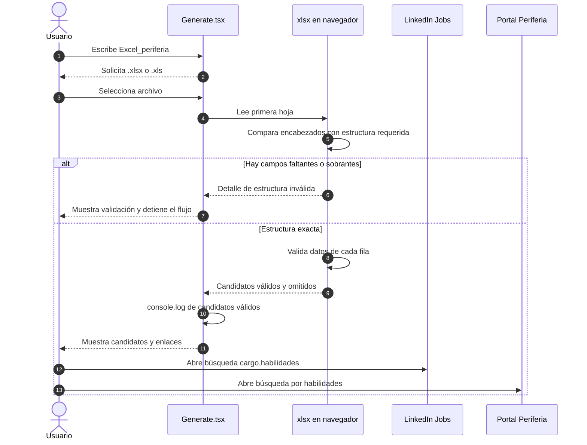

# Ficha de integración: agente OpenRouter y Excel_periferia

| Campo | Detalle |
|---|---|
| Estado | Chat y tarea Excel_periferia implementados en frontend; API Node disponible para una integración de servidor posterior |
| Frontend | React 19 + TypeScript + Vite + Tailwind |
| Modelo actual | OpenRouter con `nvidia/nemotron-3.5-lightning:free` mediante AI SDK |
| Tarea especializada | Validación local de Excel y enlaces de vacantes LinkedIn / Periferia |
| Persistencia actual | `localStorage` en el navegador |

## 1. Integración actual

`src/components/Generate.tsx` concentra la experiencia de usuario: historial, estado de carga/error, carga de Excel y visualización de candidatos. El historial se guarda bajo `agente-periferia-history-v1`; al enviar un mensaje se compone un prompt con los turnos anteriores y el mensaje actual.

`src/services/prom.service.ts` invoca `streamText` con el proveedor creado en `src/libs/ai.ts`. La clave se obtiene de `VITE_OPENROUTER_KEY`, por lo que queda expuesta al bundle del navegador. Esta implementación sirve para desarrollo, pero una versión productiva debe mover la credencial y la invocación del modelo a la API Node.

La tarea `Excel_periferia` no llama a OpenRouter ni envía el archivo a servicios externos. Usa `xlsx` en el navegador para leer la primera hoja, validar encabezados y generar enlaces de búsqueda. Los datos válidos se escriben solo en la consola local del navegador.

## 2. Flujo Excel_periferia

## 3. Contratos y reglas implementadas

| Componente | Entrada | Salida / comportamiento |
|---|---|---|
| Activación | Texto que inicia con `Excel_periferia` | Solicita adjuntar un Excel válido. |
| Archivo | `.xlsx` o `.xls` | Otro tipo muestra `Selecciona un archivo .xlsx o .xls.` |
| Encabezados | `nombre`, `cargo`, `habilidades`, `industria` | Deben ser exactamente esos cuatro. Informa faltantes y sobrantes. |
| Filas | Valores de las cuatro columnas | Acepta solo filas completas; informa cuántas fueron omitidas. |
| Consola | Candidatos aceptados | Escribe `[Excel_periferia] Candidatos validados:` con el arreglo. |
| LinkedIn | `cargo` y `habilidades` | Abre LinkedIn Jobs con ambos valores separados por coma. |
| Periferia | `habilidades` | Abre el portal de vacantes de Periferia filtrado mediante `query`. |
| Chat | Historial y mensaje | Envía el prompt a OpenRouter y agrega la respuesta al historial. |
| Error de red | Fallo de `fetch` | Conserva el turno, muestra mensaje recuperable y permite reintentar. |

## 4. Integración Node disponible

El proyecto ya contiene una API Node básica:

- `server/index.js` recibe `POST /api/chat`, valida JSON, limita cuerpo y configura CORS para Vite.
- `server/agent.js` valida roles y longitud del historial antes de construir el prompt.
- `server/services/prom.service.js` usa OpenRouter con `OPENROUTER_API_KEY` del entorno del servidor.
- `server/prom.service.test.js` cubre la serialización y la validación del historial.

El frontend actual aún usa el servicio directo `src/services/prom.service.ts`. Para adoptar la API sin cambiar la interfaz, `PromData` debe llamar a `/api/chat` y enviar `{ message, history }`; la clave `VITE_OPENROUTER_KEY` se elimina del cliente y queda únicamente como `OPENROUTER_API_KEY` en el servidor.

## 5. Recomendaciones de evolución

1. Mover OpenRouter a la API Node antes de producción para no distribuir la clave.
2. Persistir conversaciones por usuario en un servicio de datos si se requiere continuidad entre dispositivos o sesiones.
3. Si se necesita un enlace directo a una vacante específica de Periferia, incorporar una API o backend que consulte el portal, compare vacantes disponibles contra habilidades y entregue el enlace verificado. El frontend actual abre el resultado de búsqueda del portal.
4. Mantener la decisión humana para revisar vacantes y cualquier postulación.

## 6. Seguridad y privacidad

- El Excel se procesa en el navegador y no se envía automáticamente a LinkedIn, Periferia ni OpenRouter.
- Las búsquedas se abren únicamente cuando la persona pulsa los enlaces.
- Evitar exponer archivos o capturas de consola con datos personales.
- No registrar claves, prompts internos ni respuestas de error del proveedor en la interfaz.
